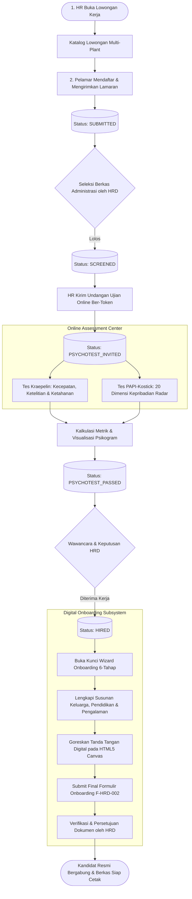

# 🌟 TalentAssess Enterprise™ Showcase
### End-to-End Enterprise Talent Acquisition, Distributed Psychometrics & Digital Onboarding

[](https://www.typescriptlang.org/)
[](https://fastify.dev/)
[](https://vuejs.org/)
[](https://www.prisma.io/)
[](https://tailwindcss.com/)
[](https://www.sqlite.org/)
[](https://opensource.org/licenses/MIT)

---

## 📌 Executive Summary

**TalentAssess Enterprise™ Showcase** adalah implementasi portofolio rekayasa perangkat lunak berskala korporasi yang mendemonstrasikan **Siklus Hidup Lengkap Rekrutmen & Asesmen Talenta (End-to-End Talent Acquisition Lifecycle)**:
1. **Job Portal & Requisition Management:** Publikasi lowongan kerja multi-plant dan penugasan baterai psikotes dinamis.
2. **Candidate Application & ATS Tracking:** Pendaftaran profil, upload berkas, dan pelacakan status pelamar secara real-time.
3. **High-Throughput Psychometric Engine:**
   * **Tes Kurva Kerja Kraepelin:** Penghitungan aritmetika instan dengan formulasi psikometri baku (*Work Capacity/Panker*, *Accuracy Rate*, *Consistency Score*, *Fatigue Index*, dan deteksi pola kurva 5 tren).
   * **Tes PAPI-Kostick:** Inventori kepribadian kerja 20 dimensi (10 Peran & 10 Kebutuhan) dengan visualisasi grafik jaring laba-laba (*spider/radar chart*).
4. **Digital Onboarding Calon Karyawan:** Wizard 6-tahap bagi kandidat berstatus **DITERIMA** (F-HRD-002), penangkapan tanda tangan digital interaktif berbasis **HTML5 Canvas**, serta verifikasi resmi oleh HRD.
5. **Interactive Portfolio Role Switcher:** Tombol *1-Click Demo Switcher* pada navigasi atas untuk berpindah seketika antara perspektif **Kandidat (Dimas)** dan **HR Recruiter (Sarah)** tanpa perlu logout/login manual!

---

## 🏗 Arsitektur Sistem & Alur Bisnis



---

## ⚡ Fitur Rekayasa Unggulan (Engineering Highlights)

### 1. Formulasi Matematis Metrik Kraepelin
* **Kecepatan Kerja (*Work Capacity / Panker*):** Total jawaban benar $\sum \text{Correct}$.
* **Ketelitian Kerja (*Accuracy Rate*):** $(\sum \text{Correct} / \sum \text{Answered}) \times 100\%$.
* **Kestabilan Ritme (*Consistency Score*):** $100 - CV$, dengan $CV = (\sigma / \mu) \times 100\%$.
* **Indeks Kelelahan (*Fatigue Index*):** $((H_1 - H_2) / H_1) \times 100\%$.
* **Deteksi Pola Kurva (*Pattern Classification*):** Menggunakan *moving averages* kuartil ($Q_1$ vs $Q_4$) untuk mengklasifikasikan kurva ke dalam 5 pola diagnostik: `flat`, `ascending`, `descending`, `peak-drop`, dan `wavy`.

### 2. PAPI-Kostick 20-Dimension Radar Profiler
Mengevaluasi 10 Peran Kerja (G, L, I, T, V, S, R, D, C, E) dan 10 Kebutuhan Kerja (N, A, P, X, B, O, Z, K, F, W), menghasilkan representasi visual *spider chart* dan teks interpretasi diagnostik kualitatif.

### 3. Digital Signature Pad (Interactive Canvas)
Komponen penangkap tanda tangan digital presisi tinggi berbasis HTML5 Canvas yang mendukung input mouse maupun sentuhan layar (*touch gestures*), mengekspor gambar transparan Base64 untuk disuntikkan ke dalam formulir arsip calon karyawan.

### 4. Zero-Setup Local SQLite Database
Menggunakan SQLite lokal yang diorkestrasi via Prisma ORM v6. Siapa pun yang meng-clone repositori ini dapat menjalankannya seketika tanpa perlu menginstal atau mengonfigurasi MySQL/PostgreSQL/Redis secara terpisah.

---

## 📂 Struktur Direktori Repositori

```text
talentassess-showcase/
├── package.json               # Root scripts untuk dev & build
├── dev.mjs                    # Runner orkestrasi otomatis server & client
├── .gitignore
├── README.md
├── server/                    # Backend Fastify v5 + TypeScript
│   ├── package.json
│   ├── tsconfig.json
│   ├── prisma/
│   │   ├── schema.prisma      # SQLite Database Schema
│   │   └── seed.ts            # Seeder akun demo & lowongan
│   └── src/
│       ├── index.ts           # Fastify REST API Endpoints
│       └── services/
│           ├── kraepelin.service.ts # Algoritma Kurva Kerja
│           ├── papi.service.ts      # Engine Radar 20-Dimensi PAPI
│           ├── application.service.ts # ATS Pipeline State Machine
│           └── onboarding.service.ts  # Prefill, TTD Canvas & Form Verifier
└── client/                    # Frontend Vue 3 + Vite + Tailwind CSS
    ├── package.json
    ├── vite.config.ts
    ├── tailwind.config.js
    └── src/
        ├── App.vue
        ├── main.ts
        ├── store/auth.ts      # Pinia Store & One-Click Role Switcher
        ├── components/
        │   ├── Navbar.vue
        │   ├── SignaturePad.vue     # Canvas Tanda Tangan Digital
        │   ├── KraepelinRunner.vue  # Interactive Kraepelin Test Runner
        │   └── PapiRunner.vue       # Interactive PAPI Radar Runner
        └── views/
            ├── HomeView.vue              # Portal Lowongan Publik
            ├── JobDetailView.vue         # Rincian Karir & Form Lamar
            ├── CandidateDashboard.vue    # Status Seleksi 5-Tahap Pelamar
            ├── AssessmentRoomView.vue    # Ruang Ujian Online (Kraepelin & PAPI)
            ├── OnboardingWizardView.vue  # Wizard Data Diri 6-Tahap F-HRD-002
            └── AdminDashboardView.vue    # HR Talent Acquisition Control Center
```

---

## 🚀 Panduan Menjalankan Project (Quick Start < 1 Menit)

### 1. Clone Repositori
```bash
git clone https://github.com/USERNAME_ANDA/talentassess-showcase.git
cd talentassess-showcase
```

### 2. Setup Otomatis (Database & Dependencies)
```bash
# Setup backend (install dependensi, push skema SQLite, & jalankan seeder)
npm run setup:server

# Setup frontend (install dependensi Vite & Vue)
npm run setup:client
```

### 3. Jalankan Aplikasi
```bash
npm run dev
```

Aplikasi akan otomatis berjalan pada:
* 🌐 **Frontend Web Portal:** [http://localhost:5173](http://localhost:5173)
* ⚙️ **Backend Fastify API:** [http://localhost:4000](http://localhost:4000)

---

## 🔑 Akun Demo Siap Pakai

Tersedia tombol **Demo Switcher (1-Click)** langsung di bilah navigasi atas (Navbar) aplikasi untuk berpindah instan:

| Peran Akun | Alamat Email | Kata Sandi | Akses & Kemampuan |
|---|---|---|---|
| **Pelamar (Candidate)** | `kandidat@example.com` | `kandidat123` | Melamar lowongan, mengerjakan tes Kraepelin & PAPI, mengisi form onboarding & tanda tangan digital. |
| **HR Recruiter (Admin)** | `admin@talentassess.com` | `admin123` | Mengubah tahapan seleksi pelamar, mengundang ujian, meninjau psikogram, dan memverifikasi berkas onboarding. |

---

## 📄 Lisensi
Dirilis di bawah lisensi [MIT](LICENSE). Terbuka untuk digunakan sebagai referensi arsitektur teknis dan portofolio profesional rekayasa perangkat lunak.
